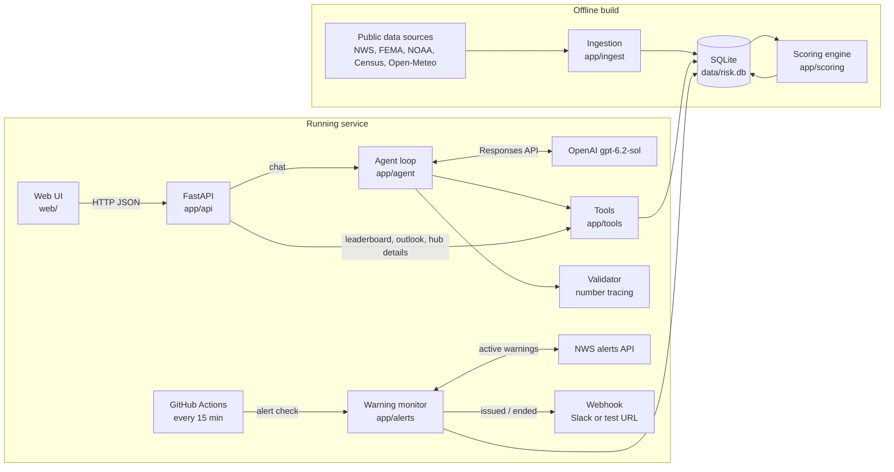

# Weather Risk Intelligence Agent: Design

This document explains how the system is built and why. The decision history, including the options we rejected, is in [DECISIONS.md](DECISIONS.md).

## 1. What the system does

A logistics company runs distribution hubs across the US and wants to know which hubs are most exposed to weather disruption, so it can decide where to invest in resilience upgrades. The system gives its analysts:

- A **chat agent** that answers questions such as "Which Midwest hubs are most exposed to winter disruption?", "Compare Miami and Houston for hurricanes and flooding", "What percentage of days in Denver last year had snowfall?" and "Why is the Dallas hub high?". It handles follow-up questions in the same conversation.
- A **ranking (leaderboard)** of all 47 hubs, filterable by hazard and region, and a **hub detail panel** with the evidence behind each score.
- A **seasonal outlook** for the current month: which hubs historically face the most disruption in that month, from which hazard, and how often it happened.

The central design rule: **the language model never produces numbers.** All scores and statistics are computed by deterministic Python code from public data. The model decides which tools to call and explains the results in plain language. Code then checks that every number in the answer appears in a tool result before the answer is shown.

## 2. Architecture



**Two halves.** The left half runs once (or whenever the data is refreshed): it downloads public data, stores it in SQLite and computes the scores. The right half is the running web service, which reads the scores from the database. This split keeps answers fast and reproducible, and the scores and chat do not depend on any external data API being available. The one live part is the warning monitor (section 8), which writes only to its own alert tables.

**Components and how they talk to each other**

| Component | Responsibility | Talks to |
|---|---|---|
| Web UI (`web/`) | Chat (typed or spoken), read-aloud, seasonal outlook, leaderboard, hub details, methodology. Plain HTML, CSS and JavaScript with no build step | FastAPI over HTTP/JSON |
| FastAPI (`app/api/main.py`) | Chat endpoint, data endpoints, health check, access code, rate limit, daily spend cap | Agent, tools |
| Agent (`app/agent/agent.py`) | Runs the conversation: sends the question to the model, executes the tools it asks for, validates the final answer | OpenAI (through `llm_client.py` only), tools, validator |
| Tools (`app/tools/`) | Nine deterministic functions: rank, compare, explain a hub, weather statistics, seasonal outlook, methodology, list hubs, find a stand-in hub, live warnings | SQLite |
| Validator (`app/agent/validator.py`) | Traces every number in the answer to a tool-result field; checks ranks and stand-in behavior | Tool outputs of the session |
| Scoring engine (`app/scoring/`) | Computes the risk measures, uncertainty ranges, monthly and seasonal statistics | SQLite |
| Ingestion (`app/ingest/`) | Downloads and caches the public data, builds the database | Public APIs and files |

**The life of one chat request**

1. The UI sends `POST /api/chat` with the message and the session id.
2. The API checks the access code, the per-IP rate limit and the daily budget.
3. The agent adds today's date and the message to the session history and calls the model with the system prompt, the tool definitions and the required answer format.
4. The model asks for one or more tools, for example `rank_hubs(hazard="winter", region="Midwest")`. The agent validates the arguments against the tool's schema, runs the tool and returns the result to the model. This repeats (at most 8 steps) until the model writes its final answer.
5. The final answer is JSON in a fixed format. The validator parses it, traces every number in the text to a tool result, checks ranks against the tools and checks that a recommended stand-in hub is not analyzed without the user's confirmation. If something fails, the model gets one retry with the specific problems listed.
6. Code attaches the traced figures and the data sources, removes typographic artifacts (dashes, ellipses) and returns the answer with a trace of the tool calls, the token usage, the cost and the latency.

## 3. Repository structure

```
weather-risk-agent/
  README.md            how to run, test and evaluate
  DESIGN.md            this document
  DECISIONS.md         decision log with alternatives and reasons
  PLAN.md              the implementation plan written at the start (kept as part of the AI session record)
  requirements.txt     pinned Python dependencies
  .env.example         configuration template (API key, access code, limits)
  app/
    config.py          settings from .env (model, effort, prices for cost tracking, limits)
    db.py              SQLite schema
    geo.py             distance helpers
    ingest/            one module per data source, plus build_db.py (build) and compact_db.py (shrink for git)
    scoring/
      params.yaml      every method parameter, versioned, with the reason for each
      engine.py        risk measures, severity shares, tiers, confidence, hub breakdown
      metrics.py       daily data (station first, model data as backup) and day-based statistics
      event_rates.py   hurricane and severe-storm rates around each hub
      seasonal.py      monthly outlook and per-hazard season profiles
    tools/
      schemas.py       input models for every tool (become strict JSON schemas)
      registry.py      tool list, schema conversion, validated execution
      hub_tools.py     the tool functions
      locate.py        find_nearest_hubs (place lookup and stand-in recommendation)
    agent/
      llm_client.py    the only module that talks to OpenAI
      answer_schema.py the final answer format the model must return
      prompts.py       system prompt
      validator.py     number tracing and behavior checks
      textclean.py     removes dashes and ellipses from answers
      sessions.py      conversation memory
      agent.py         the agent loop
      cli.py           command-line chat
    alerts/
      monitor.py       live warning monitor: checks active NWS warnings per hub, records and sends alerts
    api/
      main.py          FastAPI app
      guards.py        access code, rate limit, daily budget
  web/                 index.html, styles.css, app.js, plus vendored libraries and font
  data/
    hubs.yaml          the hub list (configuration, not code)
    risk.db            the built database (committed so the app runs without downloading anything)
  evals/               cases.yaml, checks.py, run_evals.py, results/
  tests/               unit and integration tests (no OpenAI calls)
  docs/ai-session/     the exported AI session
  .github/workflows/   alerts.yml: runs the warning check every 15 minutes
  Dockerfile, render.yaml   container image and Render deployment
```

## 4. Data

### 4.1 Sources and what each one is used for

| Source | Period | What we take | Used for |
|---|---|---|---|
| NWS warnings (Iowa Environmental Mesonet archive of National Weather Service warnings) | 2006 to 2025 | Every warning issued for each hub's forecast zone and county; storm-based warnings only when the warning polygon contains the hub | **Main measure**: days per year with a warning, per hazard |
| FEMA disaster declarations (OpenFEMA) | 1996 to 2025 | Major disasters in each hub's county, with type, title and incident dates | **Severity**: how often a warning day turned into a federally declared disaster |
| NOAA GHCN-Daily (airport weather stations) | 1996 to 2025 | Daily rain, snow, temperature, peak gusts and observed events (thunder, hail, freezing rain, ice pellets) | Evidence (snow days, heavy rain days, ice days) and weather statistics questions |
| Open-Meteo (historical reanalysis) | 2016 to 2026 | Daily weather on a grid | Fills gaps in station data; the current year |
| NOAA HURDAT2 (hurricane tracks) | 1950 to 2025 | Every Atlantic and Northeast Pacific storm track | Evidence: storms per decade within 150 km, named storms, 10-year probability |
| NOAA SPC (severe storm reports) | 1996 to 2025 | Tornado, hail and wind reports with coordinates | Evidence: report days within 50 km |
| FEMA National Risk Index | December 2025 version | Annual event frequency per hazard for every US county | Comparing a non-hub place with nearby hubs (stand-in recommendation) |
| Census Gazetteer and population estimates | 2026 and 2025 | Every US place with coordinates, land area and population | Finding non-hub places and resolving ambiguous names |
| NWS points API, FCC Area API | current | Each hub's forecast zone, county and time zone | Linking hubs to warnings and FEMA records |

All raw downloads are cached in `data/raw/` (not in git). `python -m app.ingest.build_db` rebuilds the whole database from that cache; a full rebuild reproduced every hub score exactly.

### 4.2 Why SQLite

The data is small and read-only while the service runs: about 515,000 station-days, 187,000 model-days, 32,000 places and 13,000 warnings, 49 MB in total. SQLite needs no server, ships inside the container as a single file, gives the tools plain SQL and makes the build reproducible: the file in git is exactly what the app reads.

A server database (Postgres) would become the right choice when several processes write at the same time, for example a multi-user deployment that stores conversation history and alerts, or when the hub network grows to thousands of sites. The tool layer is the only code that reads the database, so the change would be contained.

To keep the file under GitHub's limits, `compact_db.py` keeps only the latest scoring run, stores the large tables in SQLite's compact `WITHOUT ROWID` layout and empties the raw event tables that are only needed to recompute rates (the computed rates are kept).

### 4.3 Main tables

| Table | Content |
|---|---|
| `hubs` | 47 hubs: id, name, state, Census region, coordinates, county |
| `nws_warnings`, `hub_ugc` | Warnings per hub zone, county and point; each hub's NWS zone and time zone |
| `fema_declarations` | Major disasters in hub counties |
| `station_daily`, `hub_stations`, `daily_weather` | Daily weather (station and model) and the station chosen for each hub |
| `hub_event_rates` | Hurricane and severe-storm rates per hub, hazard and radius, with ranges |
| `risk_scores` | The scoring output: totals, per-hazard values, tier, and a full JSON breakdown per hub |
| `hub_monthly`, `hub_hazard_season` | Monthly outlook statistics and per-hazard season profiles |
| `places`, `nri_county` | Place lookup and county hazard profiles for stand-in recommendations |
| `ingest_log` | What was downloaded and when |

## 5. How risk is measured

### 5.1 The two measures

**Warning days per year** (routine disruption): for each hub and hazard, the number of days per year with a National Weather Service warning for that hazard at the hub. NWS warning criteria are set locally, so a warning means conditions expected to be dangerous for that specific place. This answers "how often does this hazard disrupt operations here?".

**Disaster-level days per year** (the primary ranking): warning days multiplied by the hazard's **severity share**, which is the share of warning days that fell inside a FEMA major-disaster incident period of a matching type in the hub's county. It answers "how often does this hazard reach a level that requires federal disaster assistance?". Resilience investment protects against severe events, so this is the default ranking.

Values below one day per year are also shown as "about once every N years" (for example, a disaster-level winter day in Fargo about once every 2.1 years).

Current severity shares, pooled over the 47 hubs:

| Hazard | Severity share | Basis |
|---|---|---|
| Hurricane / tropical | 46.3% | 100 of 216 warning days |
| Flood | 16.1% | 522 of 3,234 |
| Winter | 4.8% | 110 of 2,271 |
| Thunderstorm / wind | 4.4% | 267 of 6,110 |
| Heat | 0% | 0 of 2,013 |

Heat is 0% because FEMA did not declare a single heat disaster in 1996 to 2025. The system explains this as "no evidence of disaster-level heat", not "heat is harmless", and still reports heat warning days.

### 5.2 How we arrived at this measure

The measure went through several versions, each one corrected by evidence from the data:

1. **Fixed weather thresholds with hand-picked hazard weights** (for example snow over 5 cm, heat over 38 C, winter weight 0.25). Rejected: the weights were our judgment, not data.
2. **Disruption days from fixed thresholds, summed without weights.** Rejected after seeing the results: Phoenix and Las Vegas ranked first because 38 C days are ordinary there (106 per year in Phoenix), and a hurricane day counted the same as a hot day.
3. **FEMA building loss as a severity weight.** Rejected: property loss is not operational disruption.
4. **NWS warnings for frequency, FEMA declarations for severity** (the current method). Warnings are locally calibrated, which solves the Phoenix problem. Declarations measure what actually became a disaster, which gives hurricanes their real weight without anyone choosing it.

Three data problems found along the way were fixed in general ways:

- **Large counties.** Counting every flash flood or thunderstorm warning that touched Maricopa County gave Phoenix 758 flash-flood warnings; counting only warning polygons that contain the hub gives 31. Storm-based warnings are now counted only when the polygon contains the hub.
- **Misfiled disasters.** FEMA often files winter disasters as "Severe Storm" or "Flood" (for example "SEVERE WINTER STORMS AND BLIZZARD CONDITIONS"). Declarations now match a hazard by type or by title keywords; snowmelt and ice-jam titles are excluded from winter because they are floods.
- **Implausibly long warnings.** One Indianapolis areal flood warning in the archive runs 85 days (February to May 2009), while 99% of warnings of that type last 5 days or less, and no flood disaster was declared there that year. It alone supplied up to 85 of Indianapolis's flood warning days. Each warning now counts for at most the 99th-percentile duration of its own type, computed from all stored warnings (for example 5 days for areal floods and 9 for heat). This trims 123 of 13,277 warnings; the overall ranking barely changes (rank correlation 0.992), Indianapolis moves from 4th to 14th and Fargo from 5th to 10th. The cost is that genuinely long events, such as the 2011 Red River flood at Fargo, are also shortened. See DECISIONS.md, D5.

### 5.3 Supporting calculations

- **Tiers**: High, Elevated and Low are the top, middle and bottom third of the 47 hubs by disaster-level days. The scores are relative to the network, so fixed cut-offs would not mean anything.
- **Uncertainty ranges**: warning-day rates get an exact Poisson 90% interval; severity shares get an exact binomial interval; disaster-level days combine the two conservatively (the range is wider than a joint interval would be).
- **Confidence per hub**: lowered when the weather station is more than 25 km away, when the station does not measure gusts and observed events, or when modeled data had to replace station data.
- **Analyst weights**: an analyst can say "count hurricane days three times as costly"; the ranking then multiplies each hazard's days by that cost. Without it, every disaster-level day counts the same. In a real engagement these costs would come from the client's own closure data.
- **Seasonal outlook**: for each hub, hazard and calendar month, the share of years (out of 20) with at least one warning day, with a binomial range, and the expected disaster-level days for that month.
- **Season profile**: for each hub and hazard, the shortest run of months holding at least 80% of warning days, the typical date range, events per year and their typical and longest length (for example, Fargo winter: usually December 12 to March 14, about 5.3 events a year, typically 2 days).

### 5.4 Method parameters

Every threshold, radius, window and pattern lives in `app/scoring/params.yaml` with the reason for its value. Parameters were chosen for a stated reason or from a data-based test before looking at rankings, and never adjusted for a single hub. Two examples of data-based tests: the hurricane and storm radii (150 km and 50 km) were chosen after checking that hub rankings stay stable across nearby radii (rank correlation 0.83 to 0.98), and the coverage limit for stand-in hubs is computed from the hub network itself (section 6). The same data and the same parameters always produce the same output.

## 6. Places that are not hubs

When a user asks about a place that is not a hub (for example "a hub in Tampa"), the agent says there is no data for that place and calls `find_nearest_hubs`:

1. **Find the place** in the Census list (exact name, then known name patterns, then name prefix, then close spelling). The model converts nicknames and boroughs to official names first ("Brooklyn" to "New York, NY") and says so in the answer.
2. **Ambiguous names**: if exactly one match has at least 50,000 people (the Census threshold for the core city of a metropolitan area), use it; otherwise ask the user which one (Springfield returns Missouri, Massachusetts, Illinois, Oregon and Ohio).
3. **Coverage**: if the nearest hub is farther than the network's widest gap between neighboring hubs (622 km today), no hub is a meaningful stand-in and the agent says so. With today's network this covers every mainland place and excludes Alaska, Hawaii and Puerto Rico, without naming any state in the rule.
4. **Recommend a stand-in** among the 3 nearest hubs: 80% hazard-profile similarity (FEMA county frequencies for 10 hazards) plus 20% proximity. Candidates within 2 points of the best are treated as tied and the closest one wins, because county-level profiles are coarse and distance is exact.
5. **Ask before analyzing** the stand-in, then label the analysis clearly as a stand-in.

Examples: Tampa to Orlando, Charleston SC to Jacksonville (coastal, rather than the closer Charlotte), Spokane to Boise (inland, rather than the closer Seattle).

## 7. The contract between the language model and the code

- **Tools**: each tool has a Pydantic input model converted to a strict JSON schema (every field required or explicitly nullable, no extra fields). Hub ids and regions are fixed lists, so the model cannot ask for a hub that does not exist. Invalid arguments come back to the model as an error it can correct.
- **Final answer**: the model must return JSON with the answer text, question type, measure used, hubs mentioned, assumptions, uncertainty, whether it is waiting for the user's confirmation and suggested follow-ups (`app/agent/answer_schema.py`).
- **Number tracing**: code finds every number in the answer text and matches it to a tool-result field (allowing display rounding and a share shown as a percentage). Untraceable numbers trigger one retry, then a visible warning. The traced list ("1.32 comes from get_hub_risk_breakdown.severe_days_per_year") is shown in the developer view.
- **Why code builds the figure list**: the first version asked the model to list every number and its source. That made answers slow (about 60% of the output was this list) and relied on the model to describe its own sources. Moving the tracing into code cut output tokens by 45% and made it more reliable.
- **Provider isolation**: only `llm_client.py` imports the OpenAI SDK. The rest of the code uses neutral types, so changing provider means rewriting one file.
- **Cost control**: the system prompt and tool list never change, so the provider caches them (about 60% of input tokens are cached); old tool outputs are trimmed from the history; at most 8 steps per question; a daily spend cap in the API.

## 8. API and user interface

| Method | Path | Purpose |
|---|---|---|
| POST | `/api/chat` | Ask the agent; returns the answer, traced figures, sources, tool trace, cost and latency |
| POST | `/api/chat/reset` | Clear a conversation |
| GET | `/api/scores` | Leaderboard (no language model) |
| GET | `/api/outlook` | Seasonal outlook for a month (no language model) |
| GET | `/api/hubs`, `/api/hubs/{id}/breakdown` | Hub list and hub details (no language model) |
| GET | `/api/methodology` | Definitions, severity shares, sources and limitations |
| POST | `/api/admin/budget` | Raise or lower the daily spend cap while running (admin token) |
| POST | `/api/admin/alerts/check` | Run one live warning check for all hubs (admin token; called by the scheduler) |
| GET | `/api/alerts` | Warnings active at hubs now, recent alerts and the last check |
| GET | `/health` | Database status, data freshness, model, remaining budget |

The leaderboard, outlook and hub panel use the same tool functions as the agent, so the numbers on screen and in answers always agree.

**Protection for a public URL**: an access code on every `/api/*` call, 10 chat messages per minute per IP address, and a daily OpenAI spend cap (3 USD by default, adjustable at runtime) after which chat answers with a clear message while the data views keep working.

**Live warning alerts** (the assignment's bonus, `app/alerts/monitor.py`). The risk scores describe 20 years of history and change only when the data is rebuilt, so an alert on "score changed" would almost never fire. What does change day to day is whether a hub is under an active warning right now, so the monitor alerts on that:

- Every 15 minutes a GitHub Actions job calls `POST /api/admin/alerts/check`. The schedule lives outside the server because the free plan puts the server to sleep; the call wakes it.
- The check asks the NWS alerts API which alerts are active at each hub's point (47 requests in parallel, about 18 seconds) and keeps only real warnings (status Actual, significance W) of the types the scoring uses. Watches, advisories and test messages are ignored.
- Each warning is identified by its VTEC event id (office, type and event number), which stays the same through updates and extensions. Comparing with the previous check gives the warnings that were issued or ended; each becomes a row in `hub_alerts` and all of them go out in one webhook message (Slack format), for example "Oakland, CA: Coastal Flood Warning issued, until 2026-11-26 16:00 local time".
- In the chat, the tool `get_live_warnings` answers questions such as "Are any hubs under a warning right now?" from the same data, with the time of the last check and a reminder that live warnings do not change the historical scores. Without it the chat would refuse a question the screen next to it answers.
- In the web app, a "Live warnings" button in the header shows how many hubs are under a warning now and opens a list (hub, warning, end time in the hub's local time). Affected hubs get a warning icon in the leaderboard and a box at the top of their hub panel, labeled as live weather that is not part of the historical risk score. The page refreshes this every 10 minutes while open.
- Safeguards: a failed request leaves that hub unchanged (an API error never reads as "warning ended"); the first check on a fresh database is a baseline that reports warnings as "active when monitoring started" instead of new; only one check runs at a time; delivery errors are recorded with the error type only, never the webhook URL, because the scheduler logs of a public repository are public.
- Limitations: alert history is stored in SQLite on the server's temporary disk and is lost on redeploy (a production version would use a persistent database); GitHub may start scheduled runs a few minutes late.

**Voice**: voice runs entirely in the browser through the Web Speech API, so the server, the agent and the cost are unchanged.

- *Speaking a question*: the microphone button turns speech into text in the input box. The text is not sent automatically: speech recognition sometimes mishears place names, and a wrong hub name would produce a confident answer to the wrong question, so the user checks the text and presses Enter. The button is hidden in browsers without speech recognition (for example Firefox), and errors such as a blocked microphone get a plain message.
- *Reading answers aloud*: a "Read aloud" switch reads each new answer, and a speaker button on every answer reads that one. The spoken text is built from the displayed answer: one sentence per paragraph, list item and table row, without markdown symbols, and "/yr" is read as "per year". It is spoken a few sentences at a time because Chrome stops long utterances after about 15 seconds. Reading stops when a new question is asked or a new chat starts.
- *Privacy*: in Chrome, speech recognition sends the audio to Google's speech service. A production deployment that must keep audio in-house would use a self-hosted speech model instead.

**Conversation memory**: conversations are kept in the server's memory for 2 hours, which keeps the service simple and stateless on disk. On the free hosting plan the server sleeps after about 15 minutes without requests and loses that memory, as it does on every redeploy. Two measures handle this: while the page is open it checks `/health` every 10 minutes, which keeps the server awake at no model cost; and when the server receives a conversation id it no longer holds, the answer is shown with a note that the earlier conversation expired, so a follow-up question is never answered silently without its context. A production version would keep conversations in a shared store such as Redis or Postgres.

**Client view and developer view**: by default the interface shows what a client needs (the answer, a confidence badge, "Sources and reliability" with a confirmation that all figures were checked against the data, plain-language evidence in the hub panel). Tool calls, field-level number tracing, tokens and cost are available in a developer view (Methodology, "Show technical details", or `?dev=1`) for demonstrations.

## 9. Testing and evaluation

**Unit and integration tests** (`tests/`, 138 tests, no OpenAI calls): scoring functions on synthetic data, the tools and the place lookup on the real database, the live warning monitor with recorded responses, the validator and text cleanup, the agent loop with a scripted fake model, and the API including access control, rate limit, budget and outage handling.

**Evaluation of the real model** (`evals/`, `python -m evals.run_evals`): 21 cases, some with several turns, covering rankings (including analyst weights), comparisons, statistics, explanations, timing and the seasonal outlook, methodology, stand-in hubs, nicknames, ambiguous and out-of-coverage places, a false premise, a follow-up, live warnings and guardrails (an out-of-scope forecast question and a request to make up a number). Checks are deterministic: expected tool calls and arguments, expected figures and ranking order computed by calling the same tools directly (never hard-coded), required and forbidden phrases, question type and confirmation behavior, plus validation, completion and plain-text checks on every answer.

Results: before the warning-duration cap, every case run twice passed (**40 of 40**, average 10.3 seconds and 0.013 USD per answer). After rescoring with the cap, a full run passed **20 of 20** (average 11.1 seconds and 0.013 USD per answer). After adding the live warnings tool, a full run of all 21 cases passed **21 of 21** (average 11.3 seconds and 0.015 USD per answer; report in `evals/results/eval-latest.json`). That run used a copy of the database with one real live check, so the live case answered from current NWS data. The evaluations also found real problems that were then fixed: the model deciding on its own that "Springfield" is ambiguous instead of using the data, and one check that was stricter than the system prompt (it required "0.93 days per year" where the prompt asks for "about once every 1.1 years"; both forms now pass because both come from the same tool output).

## 10. Assumptions, uncertainty and limitations

- **The hub network is an assumption.** The assignment does not list hubs, so we chose 47 US cities that cover every Census region and every hazard type, using city-center coordinates. For a real client, `data/hubs.yaml` would hold their actual sites; adding a hub is one line plus a rebuild.
- **Regions** are US Census Bureau regions.
- **Warning durations are capped.** A warning counts for at most the 99th-percentile duration of its type, which removes archive outliers but also shortens real multi-week events (section 5.2).
- **Warnings are forecasts.** NWS warnings include some false alarms and misses, and their criteria and names changed over time (for example "Excessive Heat" became "Extreme Heat" in 2024; both are counted).
- **Declarations are partly policy-driven.** Federal declaration thresholds depend on statewide damage per resident, and heat is essentially never declared. Incident periods are administrative and can be longer than the weather itself.
- **Severity shares are pooled** across our 47 hubs, because we do not have warning data for every US county.
- **Disaster-level days are not closures.** They measure how often a hazard reached disaster level near the hub, not whether this company's hub actually closed. The client's own closure and cost records would be the best calibration.
- **Every disaster-level day counts the same** unless an analyst supplies day costs.
- **Station data** comes from the nearest major airport (up to 31 km away); missing days are filled with modeled data, which smooths extremes. Observed-event flags are recorded inconsistently.
- **Hazards are grouped by type, not by season.** A snowmelt flood counts as flooding, because the investment response (drainage, barriers) is a flood response; the season profile shows when each hazard happens.
- **The past does not fully predict the future.** All figures are historical frequencies; the interface and the answers say "not a forecast".
- **Language model behavior** is checked by evaluations and the validator, but a model can still word something imprecisely; numbers cannot be invented without a visible warning.

## 11. What we chose not to build, and how it would work

- **Alerts on historical score changes**: a job that refreshes the warning archive, re-scores and alerts when a hub's tier changes. Built instead: live warning alerts (section 8), because the historical scores barely change between rebuilds. A tier-change alert would fit naturally into the yearly data refresh.
- **MCP server**: exposing the same tools to any MCP-compatible assistant (for example Claude Desktop). The tool registry already has everything needed; it would be a thin wrapper.
- **Assessment of any US address on demand**: the same warning-day method applied to a location's own NWS zone, using live API calls instead of the pre-built database.
- **Broader place lookup**: Census county subdivisions, counties and ZIP codes.
- **Client calibration**: replacing pooled severity shares and equal day costs with the client's own closure history and cost per day.
- **Production concerns**: Postgres for shared state, authentication instead of an access code, monitoring of model quality and cost over time.
